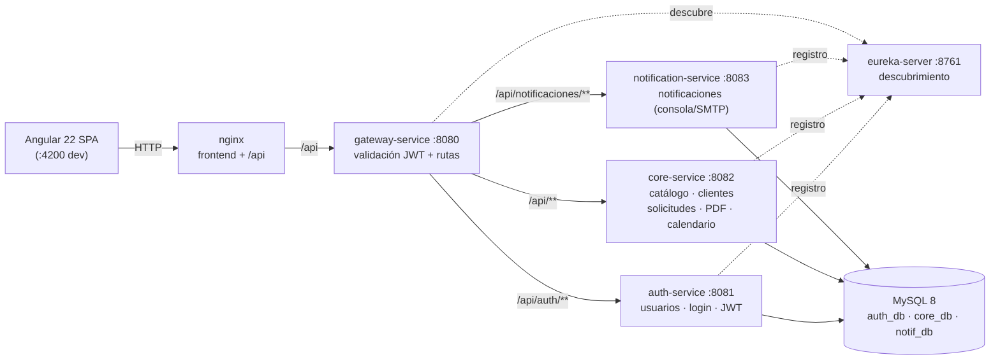

# Elixir Cocktails — Velvet & Gilt

Plataforma de cotización y gestión de servicios de **mixología para eventos**. Permite a un cliente armar su paquete (tipo de evento, invitados, cócteles) y recibir una cotización con folio, seguimiento público y PDF; y al administrador gestionar catálogo, clientes, solicitudes y notificaciones.

## Stack

| Capa | Tecnología |
|---|---|
| Backend | Java 25, Spring Boot 4.1.1, Spring Cloud 2025.1.2 |
| Frontend | Angular 22, TypeScript, CSS propio |
| Base de datos | MySQL 8 (database-per-service) + Flyway |
| Seguridad | JWT (HS256), Spring Security, rate limiting, validación de uploads |
| Infraestructura | Docker + Docker Compose, Eureka, Spring Cloud Gateway |

## Arquitectura



## Funcionalidades

- **Cotizador público en 3 pasos**: tipo de evento, invitados y duración; selección de cócteles por categoría/destilado; datos del cliente y desglose automático.
- **Seguimiento público por token**: estado de la solicitud, resumen, PDF y contacto por WhatsApp.
- **Panel admin**: dashboard, solicitudes, calendario, catálogo de cócteles (con subida de fotos), clientes y configuración.
- **PDF de cotización** generado con openhtmltopdf.
- **Notificaciones** por correo (consola/SMTP) ante solicitud creada o cambio de estado.
- **Seguridad**: JWT, token interno entre gateway y servicios, rate limiting en login y cotizaciones, validación de imágenes por magic bytes y cabeceras de seguridad en nginx.

## Cómo ejecutar

Requisitos: Docker Desktop.

```bash
cp .env.example .env
# Edita .env con JWT_SECRET, INTERNAL_TOKEN, ADMIN_PASSWORD, etc.
docker compose up -d --build
```

- Frontend: `http://localhost`
- API (vía nginx): `http://localhost/api`
- MySQL: `localhost:3306`

## Estructura

```
auth-service/          login, usuarios, roles, emisión de JWT
core-service/          catálogo, clientes, solicitudes, PDF, calendario
notification-service/  notificaciones y envío
gateway-service/       enrutamiento y validación de JWT
eureka-server/         descubrimiento de servicios
frontend/              Angular 22 (panel público y admin)
docker/                configuración de infraestructura
carta-cocteleria/      carta estática de cócteles
docker-compose.yml     stack completo
```

## Notas

- Proyecto personal de portafolio.
- Los secretos se manejan por variables de entorno (`.env`, no versionado).
- Los servicios están preparados para desplegarse en una VM (ver `deploy.sh`).
